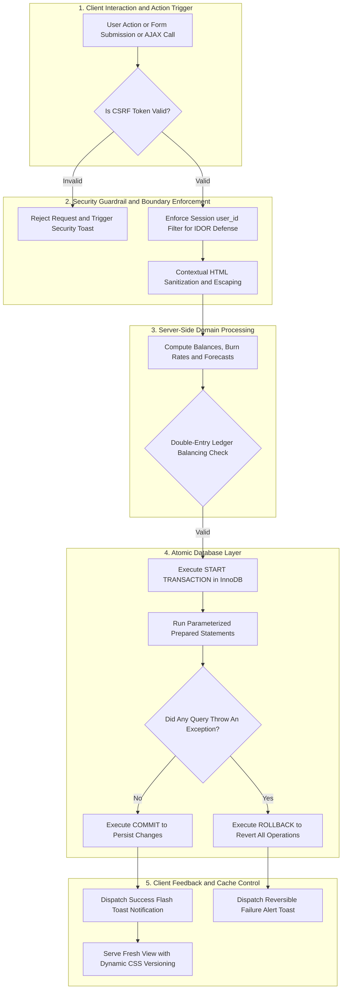
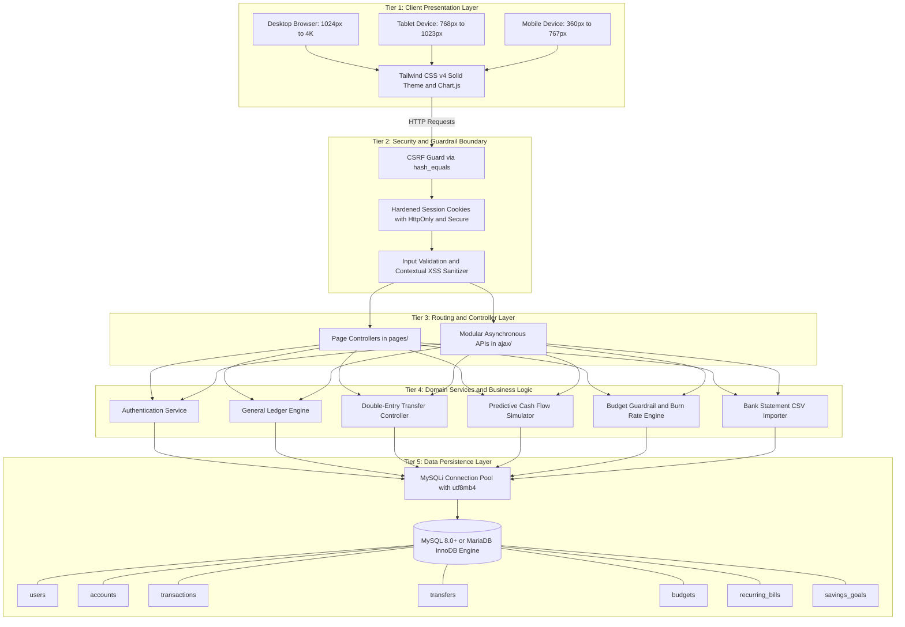
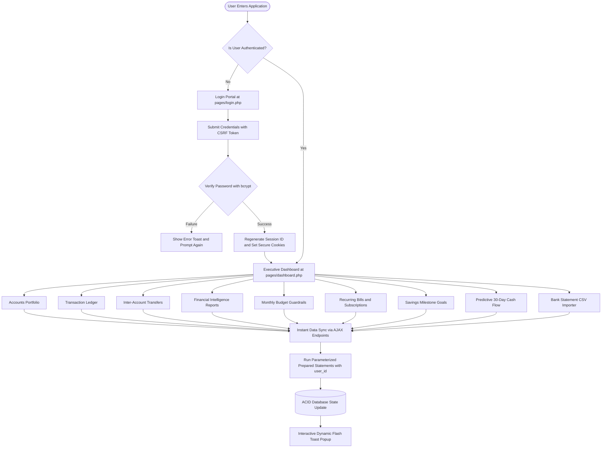
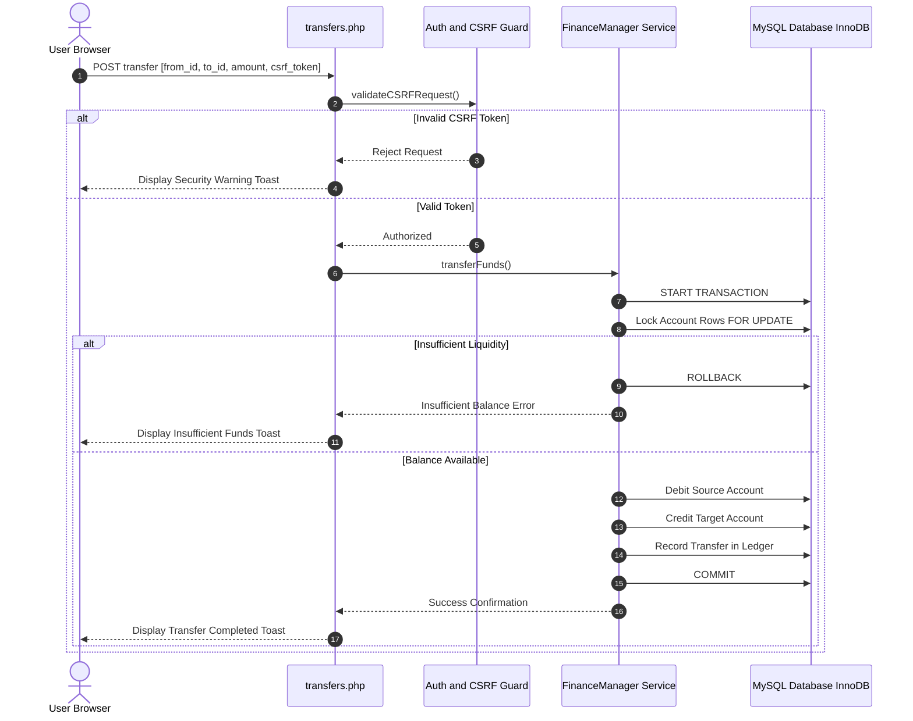
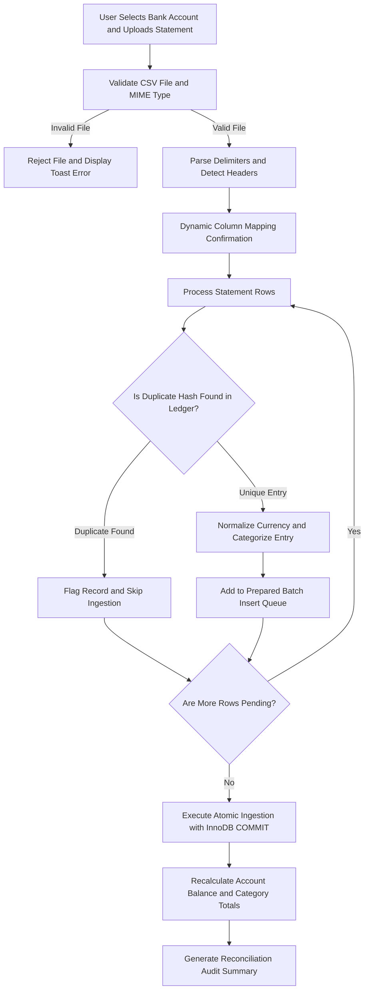
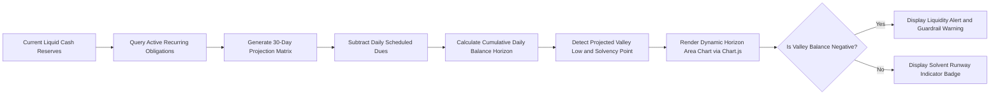
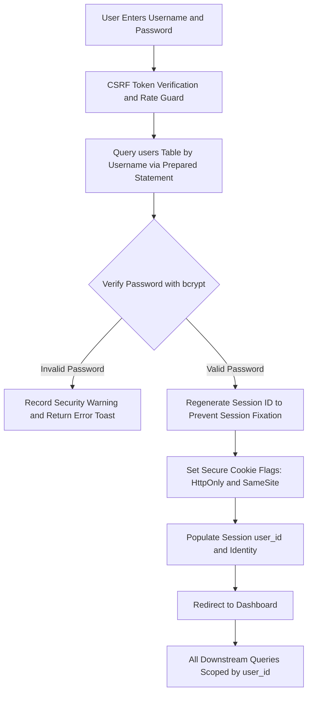

# Personal Finance Manager (PFM)

[](https://www.php.net/)
[](https://www.mysql.com/)
[](https://tailwindcss.com/)
[](LICENSE)
[]()
[]()

---

## 1. System Design (Diagram Flow)



---

## 2. System Architecture & Topology (Diagram Flow)



---

## 3. End-to-End Application Workflow (Diagram Flow)



---

## 4. Core Process Flow Diagrams

### 4.1. Atomic Inter-Account Transfer Execution Flow



---

### 4.2. Automated Bank Statement CSV Reconciliation Flow



---

### 4.3. Predictive 30-Day Cash Flow Simulation Engine Flow



---

### 4.4. Authentication, Session Hardening & Multi-Tenant Scoping Flow



---

## 5. Core Modules & Capabilities

| Module | Features & Capabilities |
| :--- | :--- |
| **Institutional Dashboard** | Real-time net worth calculation, monthly cash inflow vs. outflow velocity, quick transfer launcher, recent audit log, and category expenditure charts. |
| **Multi-Account Portfolio** | Checking, savings, credit cards, investments, and operational cash reserves. Tracks account numbers, balances, institution types, and status. |
| **Transaction Ledger** | Categorized income and expense logging with date filtering, category badges, dynamic search, and custom pagination. |
| **Double-Entry Transfers** | Atomic inter-account capital transfers with ACID transaction boundaries (`COMMIT` / `ROLLBACK`) ensuring zero funds discrepancy. |
| **Predictive Cash Flow** | 30-day forward-looking reserve projections based on scheduled income, recurring obligations, and historical spend velocity. |
| **Budgets & Allocations** | Category-specific monthly budget caps with live visual utilization meters and overspend warning indicators. |
| **Bills & Subscriptions** | Recurring liability tracker with due-date monitors, frequency engines (Monthly, Yearly, Weekly), and one-click payment logging. |
| **Savings Goals** | Target capital milestones, automatic percentage completion meters, target date calculators, and dedicated fund deposits. |
| **Bank Statement Importer** | Automated CSV parser with intelligent column schema mapping, duplicate transaction filtering, and batch ledger insertion. |
| **Financial Intelligence & Reports** | Cash flow breakdown by custom date ranges, category distribution charts, high-volume vendor analysis, and print-ready summary exports. |

---

## 6. Production CSS Build & Dynamic Cache-Busting

```html
<!-- Automatically rendered in all 12 page templates based on filemtime -->
<link rel="stylesheet" href="../assets/css/tailwind.css?v=20261114161839">
```

### Build Commands:
```bash
# Build and minify production stylesheet (updates ?v= timestamp automatically)
npm run build:css

# Watch for CSS changes in development
npm run watch:css
```

---

## 7. Architecture & Directory Layout

```text
Personal-Finance-Manager/
├── .htaccess                   # Apache server hardening, custom error handlers & security headers
├── ajax/                       # Modular AJAX endpoints for asynchronous actions
│   ├── accounts.php            # Account creation, editing, and status updates
│   ├── bills.php               # Recurring bills management & mark-as-paid handler
│   ├── budgets.php             # Budget creation & allocation limits
│   ├── filters.php             # Dynamic transaction filtering & search queries
│   ├── goals.php               # Savings goals tracking & deposit contributions
│   ├── import.php              # CSV bank statement parsing & batch ingestion
│   ├── login.php               # Authentication verification endpoint
│   ├── profile.php             # User profile, currency preferences & password changes
│   └── transactions.php        # Transaction CRUD operations
├── assets/                     # Frontend compiled assets & vectors
│   ├── css/
│   │   ├── input.css           # Tailwind CSS v4 source file with @source directives
│   │   └── tailwind.css        # Minified production stylesheet with cache-busting
│   └── img/
│       ├── account.svg         # Corporate account vector graphic
│       └── logo.svg            # Official brand mark with Rupee (₹) emblem
├── config/                     # Core runtime configuration
│   ├── constants.php           # Global application constants, asset_version() helper & session timers
│   └── database.php            # 4-parameter MySQLi connection pool with utf8mb4
├── includes/                   # Core business logic & shared UI templates
│   ├── auth.php                # Authentication class, session manager & CSRF guards
│   ├── footer.php              # Global footer with responsive layout & status indicator
│   ├── functions.php           # Ledger balance calculations, metrics & sanitization
│   └── header.php              # Navigation header, dropdown controller & meta tags
├── pages/                      # Application route controllers
│   ├── 403.php                 # 403 Access Forbidden error page
│   ├── 404.php                 # 404 Not Found error page
│   ├── 500.php                 # 500 Internal Server Error page
│   ├── accounts.php            # Accounts portfolio management
│   ├── bills.php               # Bills & subscription obligations
│   ├── budgets.php             # Budget limits & expenditure meters
│   ├── dashboard.php           # Main analytics dashboard & net worth overview
│   ├── forecast.php            # 30-day cash flow engine & forecast charts
│   ├── goals.php               # Savings targets & progress meters
│   ├── import.php              # CSV statement importer & column mapper
│   ├── login.php               # Secure user login portal
│   ├── profile.php             # Account settings & security preferences
│   ├── reports.php             # Financial intelligence & analytical charts
│   ├── transactions.php        # General ledger & transaction records
│   └── transfers.php           # Inter-account transfer execution
├── finance_manager.sql         # Production database schema & initial seed data
├── index.php                   # Gateway entrypoint & session route dispatcher
├── LICENSE                     # MIT License
├── logout.php                  # Safe session invalidator & redirect handler
├── package.json                # Tailwind CSS v4 compiler tooling & scripts
└── README.md                   # Repository documentation
```

---

## 8. Installation & Database Setup

### 1. Database Initialization
```sql
CREATE DATABASE finance_manager CHARACTER SET utf8mb4 COLLATE utf8mb4_unicode_ci;
```
Import schema from `finance_manager.sql`:
```bash
mysql -u root -p finance_manager < finance_manager.sql
```

Default credentials:
- **Username**: `admin`
- **Password**: `password`

### 2. Database Configuration
In [config/database.php](config/database.php):
```php
$this->host = getenv('DB_HOST') ?: 'localhost';
$this->username = getenv('DB_USER') ?: 'root';
$this->password = getenv('DB_PASS') !== false ? getenv('DB_PASS') : '';
$this->database = getenv('DB_NAME') ?: 'finance_manager';
```

### 3. Running Locally
```bash
php -S localhost:8000
```
Navigate to `http://localhost:8000`.

---

## 9. Free Hosting & cPanel Deployment

Compatible with shared hosts (InfinityFree, 000webhost, Hostinger, cPanel, Plesk):
1. **Upload Files**: Transfer repository files to `public_html/` or `htdocs/`.
2. **Create Database**: Create MySQL database & user in cPanel.
3. **Import SQL**: Import [finance_manager.sql](finance_manager.sql) in phpMyAdmin.
4. **Update DB Credentials**: Configure host, user, password, and database in [config/database.php](config/database.php). Standard 4-parameter `mysqli` connection requires no port.

---

## 10. Developed By & License

**Amudhan Mohan** — *Full Stack Developer & Software Engineer*  
Licensed under the [MIT License](LICENSE).
